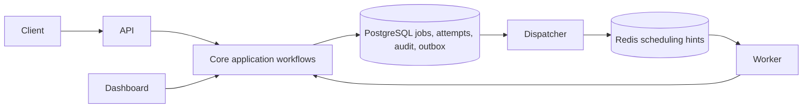

# Reliable Queue V2 architecture

The API accepts durable work. PostgreSQL owns lifecycle state and audit history. Redis accelerates selection of ready work. API, workers, dispatcher, and dashboard are separate processes in one monorepo; they share application rules rather than separate implementations.



## ADR 001: Explicit dependency boundaries

Core defines job types, input invariants, retry policy, application operations, and narrow ports. It has no framework, environment, database, logging backend, or timer imports. Infrastructure implements atomic lifecycle workflows and queries. SQL and Lua reside there. Contracts define HTTP schemas and serializers. Process entry points own dependency construction and cleanup.

Each repository method represents a transactional business operation rather than generic CRUD. PostgreSQL-specific locking stays in the adapter; core decides retry disposition. This keeps business policy testable without pretending that distributed consistency can be achieved by generic persistence interfaces.

`npm run architecture:check` checks package imports, prohibited storage imports, relative boundary crossings, and SQL outside infrastructure. ESLint rejects explicit `any`. Core changes require unit tests; persistence changes require PostgreSQL tests. Shared contracts prevent drift between API and dashboard replay behavior.

## ADR 002: Durable acceptance and at-least-once delivery

Enqueue, retry, replay, and recovery write the job transition, audit, and outbox in the same PostgreSQL transaction. A committed enqueue is accepted even while Redis is unavailable. A dispatcher reserves outbox batches with `SKIP LOCKED`, commits, publishes outside the transaction, and records publication using its reservation token. Crashed or timed-out reservations expire.

Every hint contains `(job ID, scheduling generation)`. Retries and replay increment generation. Old publication cannot overwrite newer schedules. Atomic Lua removal picks the highest ready priority among ten sorted sets sharing a Redis hash tag. Priority ties are deterministic by availability time and UUID; strict priority can starve lower priorities under sustained high-priority traffic.

PostgreSQL conditionally grants a claim only for the expected queue, pending status, matching generation, due availability, and remaining attempt budget. Duplicate or stale hints never grant duplicate ownership. Redis loss and the Redis-pop/database-claim crash window are repaired by paginated reconciliation of pending jobs. Clock skew can delay selection until reconciliation; PostgreSQL time remains authoritative for availability and ownership.

## ADR 003: Fenced, renewable execution

A claim increments attempts, assigns a unique lease token, and records an attempt atomically. Renewal, completion, and failure require the current, unexpired token. Old workers cannot mutate a reclaimed job. Expired processing leases consume their attempt and are retried or dead-lettered in locked recovery batches. A worker heartbeat reports liveness; it does not grant job ownership.

Handlers receive an AbortSignal, attempt ID, execution cycle, and logger. Workers renew while executing and draining. Deadline, lease loss, and forced drain cancel execution. Handlers must honor cancellation. If they ignore it, the worker exits after the cancellation grace; a process supervisor restarts it and outstanding leases recover.

Handler success followed by failed acknowledgement is logged as a storage failure, never converted into a handler nack. The lease later recovers if completion was not committed. This can repeat external effects: **handlers must use a stable idempotency key, such as the job ID plus execution cycle, with downstream systems.** There is no exactly-once promise.

## ADR 004: Replay and legacy history

Replay locks the active dead-letter entry, transitions the corresponding dead job once, starts a new execution cycle, clears stale result/error, and atomically schedules dispatch. Historical dead letters remain stored but disappear from the active listing. Attempt counters reset for the new cycle; previous attempt records remain.

Legacy data is imported without changing identifiers, payloads, timestamps, or terminal states. V1 only retained partial error history; imported attempts explicitly carry `history_complete=false`. Duplicate legacy DLQ records are archived, not deleted. Legacy `failed` jobs remain terminal and readable. No automatic retention runs. The explicit retention command preserves audit records and active dead letters.

## ADR 005: Private service security and operations

Producer keys are queue-scoped; administrator keys may manage the DLQ and diagnostics. Keys are random and only SHA-256 hashes are stored. CLI provisioning, rotation, and revocation are audited. Dashboard passwords use salted scrypt hashes. Sessions and CSRF hashes live in PostgreSQL, so dashboard access does not depend on Redis. Production sessions require HTTPS.

Dashboard rendering uses text nodes. Protected-route checks use Fastify's matched route rather than raw URL prefixes. SSE clients share a non-overlapping sampler and are disconnected on expiry, slow writes, or shutdown. API readiness needs PostgreSQL; worker/dispatcher readiness needs PostgreSQL and Redis. Health payloads do not expose credentials. Prometheus metrics and alerts distinguish durable backlog, dispatch lag, attempts, leases, and worker health.

Use a separate migration owner and a runtime database role in production. `packages/infrastructure/src/sql/runtime-permissions.sql` grants the runtime role data access and read-only access to the migration ledger without DDL privileges. Create its credential outside the repository and run migrations/retention with the owner credential.

## Handler contract

Set `HANDLER_MODULE` to an absolute compiled module path available in the container. Export `handlers`, a map of queue names to async functions. Each worker consumes `QUEUE_NAME` and refuses startup if its handler is absent. `DEMO_MODE=true` explicitly enables the local simulated handler; production deployment disables it.

```js
exports.handlers = {
  default: async (job, context) => {
    // Use context.signal for fetch/database calls that support cancellation.
    // Use `${job.id}:${context.executionCycle}` to deduplicate external effects.
    context.logger.info({ jobId: job.id, attemptId: context.attemptId }, 'Executing work');
    return { processed: true };
  },
};
```

Shutdown stops polling/admission, waits for active executions while renewing leases, aborts remaining work at the drain deadline, stops background loops, then closes connections. All resources belong to their runtime instance; signal handling and process exit are confined to entry points.
